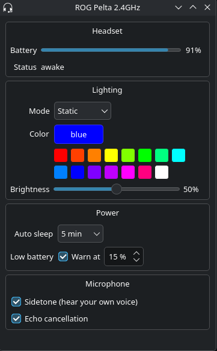

# ROG Pelta for Linux

Linux tools for the **ASUS ROG Pelta** wireless headset, used with its 2.4 GHz USB dongle or connected directly by USB-C cable:

- **Fixes the volume bug.** On Linux the headset wakes from sleep at max volume no matter what the system volume is. A small background service catches every wake and puts the volume back.
- **Battery in the system tray**, with a charging indicator, a low-battery notification and a "fully charged" notification.
- **Settings without Armoury Crate**: RGB lighting, auto-sleep timer, low-battery alert and spoken warning, sidetone on/off and volume, echo cancellation, voice prompt language and 2.4 GHz link quality, from a settings window or the command line.
- **Firmware versions** of the headset and dongle, with an on-demand check for updates.

Everything runs as your normal user. Root is only needed once, to install a udev rule.

**Source code:** [github.com/jimm0thy/pelta-control](https://github.com/jimm0thy/pelta-control)

**This project has been vibe coded with Claude**




## Install

The installer uses `sudo` to install packages and the udev rule, so you may want to read [`install.sh`](https://github.com/jimm0thy/pelta-control/blob/main/install.sh) and the [scripts it installs](https://github.com/jimm0thy/pelta-control/tree/main/bin) first.

```
git clone https://github.com/jimm0thy/pelta-control.git
cd pelta-control
./install.sh
```

The installer:

- installs any missing dependencies with pacman, apt, dnf or zypper (see [Other distros](#other-distros))
- copies the scripts to `~/.local/bin`
- installs the udev rule to `/etc/udev/rules.d/` (asks for your sudo password)
- installs and starts the `pelta-wake` user service
- adds a **ROG Pelta** entry to the app launcher, and starts the tray app at login
- starts the tray app

Run `./install.sh` again after pulling updates. To remove everything, run `./install.sh --uninstall`.

## Usage

### Tray icon and settings window

The tray icon shows the battery level in steps of 10%, with a plug badge while charging. Hover over it for the exact percentage. **Left-click** it (or right-click → **Settings…**) to open the settings window:

| Section | What it does |
|---|---|
| Headset | Battery level, status (awake, asleep, charging), firmware versions and a **Check for updates** button |
| Lighting | Mode (static, breathing, strobing, color cycle, off), color picker or preset swatches, brightness |
| Power | Auto-sleep timer, low-battery alert level and spoken low-battery warning |
| Audio | Sidetone on/off and volume, echo cancellation, voice prompt language |
| Connection | 2.4 GHz link quality, from 1 (lowest latency) to 4 (highest quality). Only available with the dongle |

The window reads the current settings from the headset each time it opens, and again when the headset wakes or the connection changes, so it always shows what the headset actually has. While the headset is asleep, the settings are greyed out; the Firmware row still shows the dongle's version when the dongle is connected. Changes are sent to the headset as you make them. Closing the window hides it; the tray icon keeps running. If you quit the tray app, start it again from **ROG Pelta** in the app launcher.

If KDE hides the icon in the tray's overflow area, right-click the tray → **Configure System Tray → Entries** and set the Pelta entry to **Always shown**.

### Command line: `pelta-ctl`

```
pelta-ctl status                      # battery, firmware and every setting the headset reports
pelta-ctl firmware                    # headset and dongle firmware versions
pelta-ctl firmware --check            # compare with the latest firmware from ASUS

pelta-ctl rgb static purple -b 100    # mode, color, brightness (0-100, default 50)
pelta-ctl rgb breathing 00aaff        # hex colors work too
pelta-ctl rgb strobing red
pelta-ctl rgb cycle -b 75             # color cycle ignores the color
pelta-ctl off                         # lights off
pelta-ctl colors                      # list color names

pelta-ctl sleep 10                    # auto-sleep: never, 2, 3, 5, 10 or 15 minutes
pelta-ctl alert 20                    # low-battery alert at 20% (5-50; ASUS offers 10-50 in steps of 10)
pelta-ctl alert off
pelta-ctl alert-voice off             # spoken low-battery warning on / off

pelta-ctl sidetone on                 # on / off
pelta-ctl sidetone 6                  # sidetone volume 0-20 (default 10)
pelta-ctl echo-cancel on              # on / off
pelta-ctl voice english               # voice prompts: english, chinese or tones

pelta-ctl quality fast                # 2.4 GHz quality: fast, high, or level 1-4 (1 = lowest latency)
pelta-ctl latency 2                   # alias for quality
pelta-ctl quality status              # read the current level from the dongle
```

**Color names:** red, orange, amber, yellow, lime, green, mint, cyan, sky, blue, purple, violet, magenta, pink, white. They aren't case-sensitive. Some are adjusted for LEDs, which make mixed colors look more yellow than a screen does (orange is `ff4000`, for example).

**Lighting** commands set everything at once: anything you leave out goes back to its default. `pelta-ctl rgb static green` sets brightness to 50 even if it was at 100.

**Sleep timer, alert and quality** are read back after each change, so the command tells you if the headset didn't take it. Settings need the headset to be awake.

**Sidetone and static:** sidetone feeds the mic straight into your ears, so a cheap or noisy mic can hiss. Lowering the sidetone volume (`pelta-ctl sidetone 5`, for example) reduces it.

### What `status` can and can't read

The headset reports almost everything when asked: battery, charging, firmware versions, sleep timer, low-battery alert and spoken warning, lighting, sidetone and its volume, voice prompt language, and (through the dongle) the 2.4 GHz quality. So `status` and the settings window show the real values, even if something else changed them.

The one exception is **echo cancellation**, which the headset can't report. `pelta-ctl` and the settings window remember the last value they set in `~/.config/pelta/settings.json`.

### Battery and notifications

The `pelta-wake` service reads the battery level when it starts, every time the headset wakes, and whenever the headset reports a change. It sends a desktop notification:

- when the battery drops to the headset's low-battery alert level (set with `pelta-ctl alert` or the settings window; no notification if the alert is off)
- when charging reaches 100%

While the headset is asleep or off, the tray shows the last known level, marked **last known** in the tooltip.

### Wired (USB-C) mode

With the headset plugged in by cable, it shows up as its own USB device (`0b05:1b82`) instead of the dongle (`0b05:1b84`), with the same command interface. The udev rule matches both, so the tray, settings window and `pelta-ctl` work the same way, and the battery shows as charging. The headset shouldn't sleep while wired, so the volume fix has nothing to do in this mode.

Each connection gets its own device: `/dev/pelta-hid-dongle` and `/dev/pelta-hid-usb`. The daemon checks every few seconds which one is present and switches automatically, preferring the cable when both are connected. This includes the headset's mode switch: with both the dongle and cable connected, switching to 2.4 GHz removes the headset's USB device, so the daemon falls back to the dongle, and switching back brings the USB connection back within a few seconds. The settings window's title and the tray tooltip show the current connection (**ROG Pelta 2.4GHz** or **ROG Pelta USB**), and `pelta-ctl status` prints it.

The **2.4 GHz quality** setting is handled by the dongle and only applies in 2.4 GHz mode. The tray's Connection section is disabled in USB-C mode; `pelta-ctl quality` still requires the dongle.

## Files

| Installed to | What it is |
|---|---|
| `~/.local/bin/pelta-wake-hid` | Background daemon: wake volume fix and battery tracking |
| `~/.local/bin/pelta-recover` | Re-syncs the headset volume after a wake (called by the daemon) |
| `~/.local/bin/pelta-ctl` | Command-line tool |
| `~/.local/bin/pelta-tray` | Tray icon and settings window (must sit next to `pelta-ctl`) |
| `~/.config/systemd/user/pelta-wake.service` | User service that runs the daemon |
| `/etc/udev/rules.d/70-pelta.rules` | Creates `/dev/pelta-hid-dongle` / `/dev/pelta-hid-usb` and gives your user access to them |
| `~/.local/share/applications/pelta-tray.desktop` | App launcher entry |
| `~/.config/autostart/pelta-tray.desktop` | Starts the tray app at login |

Runtime files: `$XDG_RUNTIME_DIR/pelta.json` (current status, written by the daemon), `~/.cache/pelta-battery` (last known level), `~/.config/pelta/settings.json` (last-set echo cancellation).

`tools/pelta-probe` isn't installed. It sends the headset's status queries and prints the raw replies, which is useful for working out new parts of the protocol.

## Requirements

- Linux with PipeWire (`pactl` from `libpulse` / `pipewire-pulse`)
- systemd (user services) and udev
- Python 3 and PyQt6
- `notify-send` (libnotify)

Tested on CachyOS with KDE Plasma 6. The tray app should work on any desktop with a system tray, but the battery icons come from your icon theme, so they may look different outside KDE.

### Other distros

Nothing in the tools is Arch-specific. The installer detects your package manager and installs these:

| | Arch / CachyOS | Debian / Ubuntu | Fedora | openSUSE |
|---|---|---|---|---|
| PyQt6 | `python-pyqt6` | `python3-pyqt6` | `python3-pyqt6` | `python3-PyQt6` |
| notify-send | `libnotify` | `libnotify-bin` | `libnotify` | `libnotify-tools` |
| pactl | `libpulse` | `pulseaudio-utils` | `pulseaudio-utils` | `pulseaudio-utils` |

`pactl` works with PipeWire as well as PulseAudio. Package names can change between releases; if the install fails, install the equivalents yourself and run `./install.sh` again.

- **Older releases:** PyQt6 is packaged in Debian 12 and Ubuntu 22.04 and newer. On older releases, install it with `pip install --user PyQt6`.
- **GNOME:** GNOME has no system tray by default, so the battery icon won't appear. Ubuntu already includes the AppIndicator extension. On Debian and other GNOME setups, install and enable **AppIndicator and KStatusNotifierItem Support** (Debian package `gnome-shell-extension-appindicator`), then log out and back in. The installer warns if it's missing. The volume fix, notifications and `pelta-ctl` work without it.
- **`~/.local/bin` not in PATH:** Debian and Ubuntu only add it at login if the folder already exists, so on a new account you may need to log out and back in once after installing.
- **PulseAudio instead of PipeWire:** the tools should work, but the wake bug and fix have only been tested with PipeWire.

## ASUS Gear Link

ASUS's web app [Gear Link](https://gearlink.asus.com/en) can also configure the Pelta and shows its firmware version. It works on Linux in Chromium-based browsers (Edge, Chrome and similar; tested in Edge on CachyOS), but not in Firefox, which doesn't support WebHID. The browser needs read/write access to the headset's HID device, which the udev rule from this project provides.

Settings changed in Gear Link show up in `pelta-ctl status` and the settings window too, since both read them from the headset (except echo cancellation). Gear Link's firmware update downloads a Windows tool (`ROG Firmware Update Tool.exe`), so firmware updates still need Windows.

**Checking for updates:** `pelta-ctl firmware --check` and the settings window's **Check for updates** button read the latest version from the same file Gear Link uses (`https://gearlink.asus.com/firmware-update-tools/7044/windows/manifest.json`) and compare it with your headset and dongle. With only the dongle connected (the headset switched off or asleep), the check still runs: it reports and compares the dongle, and says the headset wasn't checked; turn the headset on and check again for it. Connected by USB-C, it reads the headset, and also the dongle when that is plugged in too; a part that isn't present is reported as not checked. This is the only time the tools contact anything online, and only when you ask. It's an unofficial use of an ASUS file, so it may stop working if ASUS changes it.

## Troubleshooting

**`/dev/pelta-hid-dongle` (or `-usb`) doesn't exist.** Make sure the dongle (or the headset's USB-C cable) is plugged in and check that the rule matches it:

```
udevadm info /dev/hidrawN | grep -E 'ID_VENDOR_ID|ID_MODEL_ID|ID_USB_INTERFACE_NUM'
```

Try each `hidrawN` that belongs to the headset (`ls -l /sys/class/hidraw/ | grep -iE '0b05:1b8(4|2)'` lists them). The rule expects vendor `0b05`, model `1b84` (dongle) or `1b82` (cable) and interface `03`. If yours differs, change it in `udev/70-pelta.rules` and run `./install.sh` again.

**Volume still jumps to max after a wake.** Check the service log while waking the headset:

```
journalctl --user -u pelta-wake -f
```

You should see `Wake detected` and a `Restored volume` line. If the wake is detected but the volume isn't corrected, the headset needs more time after waking: raise `sleep 1` at the top of `~/.local/bin/pelta-recover` to `sleep 2`.

**The tray says "no data yet" or "last known".** The daemon only gets a reading while the headset is awake. Turn it on, or check that the service is running: `systemctl --user status pelta-wake`.

**`pelta-ctl` says the headset is asleep.** Sleep timer and alert changes need the headset awake. Lighting and mic commands are sent without a check, so they won't take effect while it's asleep either.

**No sound at 5% or lower on 2.4 GHz.** This is a limit of the dongle, not a bug in these tools. Its volume control advertises a range down to −77 dB, but on the tested unit nothing below about −75 dB is audible, and everything from there up to about −73 dB plays at the same level. PipeWire maps 5% to about −78 dB, so the bottom few percent are silent; 6% is the quietest real level. The test wrote values straight to the dongle's volume control, bypassing PipeWire, so it should behave the same on any distro. Wired and Bluetooth use different volume paths and aren't affected. To listen more quietly on 2.4 GHz, keep the system volume at 6% or above and lower the app's own volume (or its slider in your desktop's audio menu).

**Upgrading from an older root/usbmon-based fix.** The installer warns if it finds a system service whose name starts with `pelta`. Disable it with `sudo systemctl disable --now <name>` so the two don't both nudge the volume.

## How it works

### The volume bug

PipeWire controls the Pelta's volume in the headset's hardware (the sink has the `HW_VOLUME_CTRL` flag). When the headset sleeps and wakes, its firmware resets its internal volume to max, but nothing tells Linux, so PipeWire never re-sends the level. Changing the volume by any amount forces a write and fixes it.

`pelta-recover` reads the exact raw volume, nudges it up 2%, then sets the exact raw value back. Restoring the raw number instead of a rounded percentage means the volume never drifts, however many wakes there are.

Switching PipeWire to software volume (`api.alsa.soft-mixer`) avoids the bug, but this headset only accepts 16-bit audio, and doing the large volume cut in software makes audible static during playback. Hardware volume plus the wake fix sounds better.

### Detecting a wake

The dongle reports headset events as HID input reports on its vendor interface (interface 3, report ID `0xCC`). The headset has the same interface when connected by cable. The daemon reads that device directly, which needs no root, no usbmon and no polling. The udev rule gives that interface a fixed name, so it doesn't matter which `hidrawN` number or USB port it gets.

Switching the headset off and on (or through USB mode and back) also resets it to max volume, but sends no report. So while it's on the dongle, the daemon asks the dongle every 3 seconds whether the headset is connected (`cc 12 00 00 01`, answered by the dongle itself) and runs the volume fix when the answer changes from "not connected" to "connected".

### Protocol

Everything goes through report ID `0xCC`, 64 bytes, in both directions. Commands from the computer are HID output reports (`SET_REPORT`). Byte 1 is the command (`12` get, `51` set, `41` audio set, `61` audio level set), byte 2 the setting, bytes 3–4 an index, and data starts at byte 5. These were worked out from the dongle's HID descriptor and USB captures of Armoury Crate, and confirmed against the command table in ASUS Gear Link.

**Sent by the headset on its own**

| Report | Meaning |
|---|---|
| `cc 12 0e 00 00 00 00 00` | Woke up |
| `cc 12 0e …` (other bytes nonzero) | Went to sleep |
| `cc 12 09 00 00 <pct>` | Battery level changed |
| `cc 12 08 00 00 <0/1>` | Charging cable unplugged / plugged in |
| `cc 99 …`, `cc 70 …` | Button presses (play/pause); media keys arrive as report `02` |

**Status queries** (each reply starts with the same three bytes; the same queries work over the USB-C cable)

| Query | Reply |
|---|---|
| `cc 12 00 00 00` | Firmware: bytes 5–8 headset, bytes 9–12 dongle, each least-significant first (`00 07 00 04` = 4.0.7.0). The dongle part is zero over the cable |
| `cc 12 00 00 01` | Dongle: byte 5 `1` = headset connected, all zeros = asleep. Cable: byte 5 is `0` followed by the headset firmware |
| `cc 12 07` | byte 5: sleep timer (minutes, 0 = never), byte 6: battery %, byte 7: low-battery alert % (0 = off), byte 8: spoken low-battery warning on/off |
| `cc 12 08` | byte 5: `1` = charging |
| `cc 12 03` | Lighting: mode, brightness, R, G, B |
| `cc 12 13` | Lights on/off |
| `cc 12 24` / `cc 12 19` | Sidetone on/off / sidetone volume (0–20) |
| `cc 12 28` | Voice prompts: 1 English, 2 Chinese, 0 tones only |
| `cc 12 52` | 2.4 GHz quality (40, 60, 80 or 100); dongle only |
| `cc 12 0e` | Power-saving (sleep) state |
| `cc 12 18` | Demo mode |

A sleeping headset answers every query with `ff aa` in bytes 5–6. Querying `cc 12 09` (the battery push type) isn't supported and also returns `ff aa`.

**Settings**

| Command | Meaning |
|---|---|
| `cc 51 28 00 00 <mode> <brightness> <R> <G> <B>` | Lighting. Mode 1 static, 2 breathing, 3 strobing, 4 color cycle. Brightness 0–100 |
| `cc 51 37 00 00 <minutes> <alert %> <voice>` | Sleep timer, low-battery alert level (0 = off) and spoken warning, always set together |
| `cc 41 11 00 00 <0/1>` | Sidetone on/off |
| `cc 61 11 00 00 <0–20>` | Sidetone volume |
| `cc 41 0a 00 00 <1/2/0>` | Voice prompts: English, Chinese, tones only |
| `cc 41 02 00 00 <0/1>` | Echo cancellation |
| `cc 51 52 00 00 <40/60/80/100>` | 2.4 GHz link quality, 40 = lowest latency ... 100 = highest quality; dongle only |
| `cc 41 03 00 00 <0/1>`, `cc 41 04 00 00 <10 bytes>` | Sent by Armoury Crate with its EQ presets (`0x0c` = flat band). Gear Link lists these as a hardware EQ but marks it disabled for the Pelta, and they had no audible effect, so they're not implemented. Armoury Crate's EQ and virtual surround appear to be done in software on Windows |

Gear Link also defines two reset commands (`cc 50 40`, `cc 50 60`), deliberately not implemented.

For EQ on Linux, use a system-wide equalizer such as JamesDSP or EasyEffects.

## Disclaimer

Not affiliated with or endorsed by ASUS. ROG and Armoury Crate are trademarks of ASUSTeK Computer Inc. The protocol was worked out by observing the headset; use these tools at your own risk.

## License

[MIT](LICENSE)
